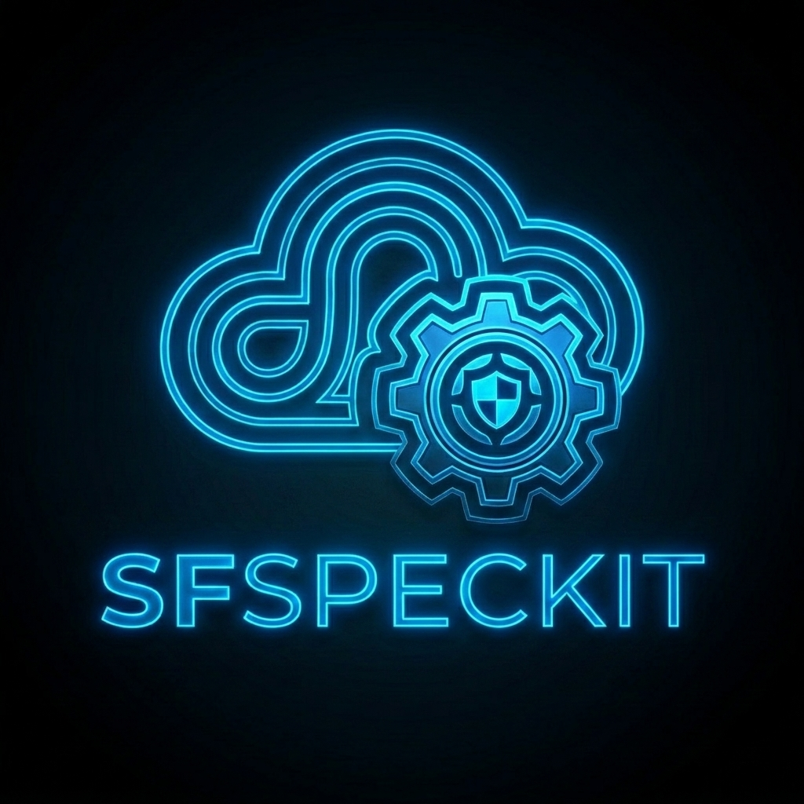
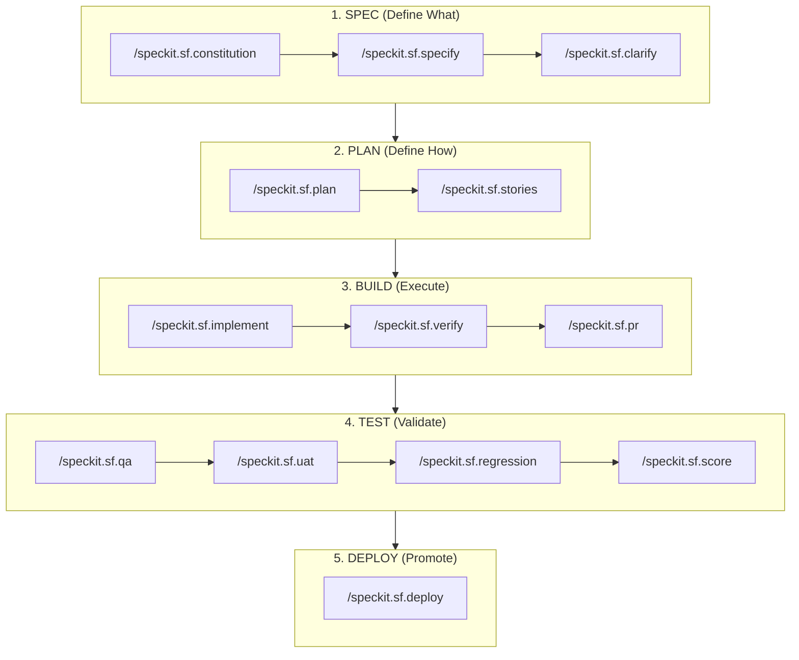

<div align="center">
  
  <h1>spec-kit-sf (SFSpeckit)</h1>
  <p><b>Enterprise Salesforce Spec-Driven Development (SDD) Framework for GitHub Spec-Kit: AI-Powered, Human-in-the-Loop Engineering.</b></p>

> ### 🚀 Official Community Announcement
> SFSpeckit is the **first-ever Salesforce extension** officially accepted into the **[GitHub Spec Kit](https://github.com/github/spec-kit)** Community Catalog—the industry-leading SDD engine maintained by GitHub with over **141,000+ stars**. Now proudly maintained and contributed to open source by Evernorth.

[](LICENSE)
[](https://github.com/github/spec-kit)
[](https://github.com/github/spec-kit/blob/main/extensions/catalog.community.json)
[](https://github.com/github/spec-kit/pull/2208)
[](https://github.com/Evernorth/spec-kit-sf)
[](https://github.com/Evernorth/spec-kit-sf/pulls)
[](CHANGELOG.md)

</div>

<br/>

SFSpeckit transforms Salesforce delivery into an evidence-based, autonomous engine driven by structured specifications.

---

## 🌟 Featured at Dreamforce 2026 🚀

SFSpeckit was featured in Salesforce's Dreamforce 2026 session, **"Explore the Agentic App Dev Roadmap,"** as an open-source GitHub Spec-Kit plugin tailored for Salesforce development.

The session covered Salesforce's evolving approach to agentic application development, including Spec-Driven Development and AI-assisted developer workflows.

🎥 **[Watch the Dreamforce 2026 session on Salesforce+](https://www.salesforce.com/plus/experience/dreamforce_2026/series/developers_at_dreamforce_2026/episode/episode-s1e17)**

* **Session:** Explore the Agentic App Dev Roadmap
* **Dreamforce:** 2026
* **Speakers:** Dan Fernandez, VP, Product, Developer Services, Salesforce; Karishma Lalwani, Vice President, Product Management, Salesforce

---

## 🏗️ Spec-Driven Development (SDD) for AI

SFSpeckit is built on the philosophy of **Spec-Driven Development (SDD)**. In the era of AI-agentic coding, jumping directly into implementation is the fastest way to hit context limits, create hallucinations, and accumulate technical debt.

### The SDD Strategy:

`Requirements (Spec) >>> Design (Plan) >>> Implementation (Build) >>> Test >>> Deploy`

> [!IMPORTANT]
> **Human-in-the-Loop (HITL) Engineering**: SFSpeckit is a Spec-Driven Development framework that enforces human validation and verification at every milestone. This ensures that the AI remains a grounded co-pilot, eliminating hallucinations and context drift through rigorous human sign-offs.

### The Tactical Lifecycle



---

## ⚡ Prerequisites

| Requirement | Minimum Version | Required? | Purpose |
| :--- | :--- | :--- | :--- |
| **Node.js** | ≥ 18.0.0 | ✅ Yes | Required runtime for developer tooling and LWC Jest tests. |
| **Salesforce CLI (`sf`)** | ≥ 2.0.0 | ✅ Yes | Core engine for all Salesforce metadata and deployments. |
| **SF Code Analyzer** | ≥ 5.0.0 | ✅ Yes | Static analysis (PMD 7) and data-flow analysis (DFA). |
| **GitHub CLI (`gh`)** | ≥ 2.0.0 | ⚠️ Optional | Automated Pull Request creation, checks, and release management. |
| **DX Project** | — | ✅ Yes | Project must be an initialized Salesforce DX project (`sfdx-project.json`). |

---

## 🚀 Installation & Setup

### Step 1: Install Spec Kit CLI

You must have the core Spec Kit toolkit installed before adding SFSpeckit:

```bash
# Install Spec Kit via uv (Official Recommended Method)
uv tool install specify-cli --from git+https://github.com/github/spec-kit.git
```

### Step 2: Add SFSpeckit Extension

Once Spec Kit is installed, you can add SFSpeckit directly:

```bash
# Add SFSpeckit to your active Salesforce project
specify extension add sf --from https://github.com/Evernorth/spec-kit-sf
```

_For specific releases:_

```bash
specify extension add sf --from https://github.com/Evernorth/spec-kit-sf/archive/refs/tags/v1.0.0.zip
```

### Step 3: Automated Environment Setup & Verification

After adding the extension, run the automated setup command inside your Salesforce DX project. SFSpeckit will detect your OS, inspect your local environment, and verify (or prompt to install) all required tooling:

```bash
/speckit.sf.setup
```

#### Environment Verification Checklist

The `/speckit.sf.setup` command automatically inspects and validates:
1. **Salesforce CLI (`sf`)**: Minimum version `2.0.0` — Core engine for Salesforce metadata retrieval, deployments, and org operations.
2. **Salesforce Code Analyzer (`@salesforce/plugin-code-analyzer`)**: Version `5.x` — PMD 7 and Graph Engine (DFA) static analysis rules.
3. **GitHub CLI (`gh`)**: Minimum version `2.0.0` _(Optional)_ — Automated pull request creation, checks, and release management.

---

## 📋 Slash Commands (18 Complete Lifecycle Tools)

| Command | Persona | Purpose |
| :--- | :--- | :--- |
| `/speckit.sf.setup` | Dev/Arch | **[SETUP]** Automated dependency checker and installer (`sf`, `gh`, `code-analyzer`). |
| `/speckit.sf.constitution` | TPO | **[DISCOVERY]** Establish project principles with 9 articles and org discovery. |
| `/speckit.sf.specify` | TPO | Create functional feature specs with object maps and security models. |
| `/speckit.sf.clarify` | Arch | **[DRIFT ALERT]** Deep gap analysis checklist and drift audit. |
| `/speckit.sf.plan` | Arch | Technical blueprint, `force-app` structure, and blast radius analysis. |
| `/speckit.sf.stories` | Arch | Break plan into Jira-ready developer stories with security matrices. |
| `/speckit.sf.implement` | Dev | **[AUTO-HEAL]** Build story with automated remediation loops (up to 3 retries). |
| `/speckit.sf.review` | TPO/Arch | TPO and Architect review of generated stories before Jira creation. |
| `/speckit.sf.verify` | Dev | Generate formal Verification Evidence documents with coverage metrics. |
| `/speckit.sf.pr` | Dev | Prepare PR with scoring gates and code review checklist via `gh`. |
| `/speckit.sf.qa` | QA | Multi-persona UI validation, Jest tests, and Apex test execution. |
| `/speckit.sf.uat` | BPO | Generate UAT scripts and manage business sign-offs. |
| `/speckit.sf.score` | QA/Arch | 555-point real-time quality scoring dashboard across Metadata, Apex, and LWC. |
| `/speckit.sf.deploy` | Arch | Multi-org promotion logic (Dev $\rightarrow$ QA $\rightarrow$ UAT $\rightarrow$ Prod). |
| `/speckit.sf.change` | TPO | Handle mid-sprint requirement changes with impact analysis. |
| `/speckit.sf.hotfix` | Dev | Emergency production patch workflow with fast-track deployment. |
| `/speckit.sf.regression` | QA | Full feature regression tests across all stories before release. |
| `/speckit.sf.release-notes` | TPO | Auto-generate release notes from completed stories and test results. |

---

## 📁 Repository Structure

SFSpeckit organizes all SDD artifacts inside the `.specify` directory to maintain a clean project root:

```text
.specify/
├── memory/
│   └── constitution.md                 # Project "North Star" principles
├── specs/                              # Feature Specifications
│   └── 001-feature-name/
│       ├── spec.md                     # Functional Spec
│       ├── plan.md                     # Technical Blueprint & Blast Radius
│       ├── verification-evidence.md    # Automated Evidence & Test Metrics
│       └── stories/                    # Developer Work Units
│           ├── 00-shell.md             # Mother Story (Metadata & Skeletons)
│           └── 01-logic.md             # Implementation Story
├── extensions/
│   └── sf/                             # Extension Config
│       └── sf-config.yml
force-app/                              # Salesforce Metadata Source
sfdx-project.json                       # Core Salesforce DX Configuration
```

---

## 🤝 Community & Governance

* **Contributing**: Please review our [Contributing Guidelines](CONTRIBUTING.md) and [Code of Conduct](CODE_OF_CONDUCT.md).
* **Changelog**: All notable releases are documented in [CHANGELOG.md](CHANGELOG.md).

---

## 👥 Original Contributors

* **Sumanth Yanamala** ([LinkedIn](https://www.linkedin.com/in/ysumanth/)), Salesforce Architect, Evernorth

This framework is a contribution to the global Salesforce community. SFSpeckit is shared as a way to give back to the ecosystem.

---

## ⚖️ License

SFSpeckit is Open Source software released under the [Apache 2.0 license](LICENSE).
